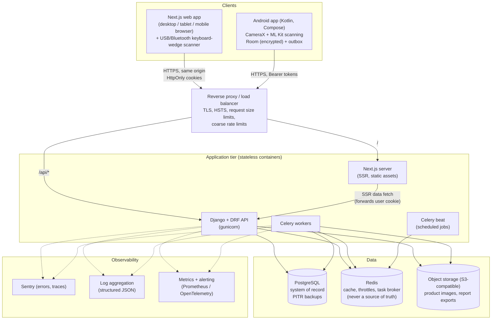
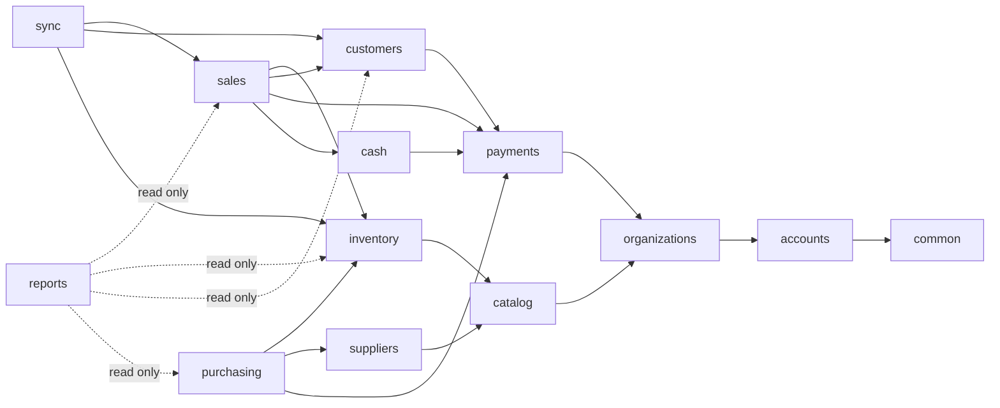

# ShopFlow — System Architecture

Status: **Draft for review** (Phase 0 deliverable). Nothing here is implemented yet.

Related documents:
[DATABASE.md](DATABASE.md) · [API.md](API.md) · [SECURITY.md](SECURITY.md) · [ROADMAP.md](ROADMAP.md) · [DECISIONS.md](DECISIONS.md)

Priority order for every trade-off in this document:
**Correctness → Security → Data integrity → Reliability → Maintainability → Performance → Usability.**

---

## 1. System context



### Component responsibilities

| Component | Responsibility | Holds business rules? |
|---|---|---|
| **Django API** | Auth, authorization, validation, every state change, reporting queries | **Yes — the only authority** |
| **PostgreSQL** | System of record; constraints, triggers and row locks enforce invariants | Yes (invariants as constraints) |
| **Next.js web** | POS and back-office UI; SSR for list/report pages, client components for POS | Display-only calculations (see §6.4) |
| **Android app** | Camera scanning, POS, offline cache, outbox sync | Display-only calculations; offline *intent capture* |
| **Celery** | Report exports, notifications, scheduled integrity checks, cleanup | Only by calling the same service layer |
| **Redis** | Cache, throttle counters, Celery broker | No. Losing Redis must not lose data |
| **Object storage** | Images and generated exports; served by short-lived presigned URLs | No |

---

## 2. Repository layout (monorepo)

```text
shopflow/
├── backend/                     Django project
│   ├── config/                  settings (base/dev/test/prod), urls, wsgi, celery
│   ├── apps/
│   │   ├── common/              base models, money/quantity types, errors, pagination,
│   │   │                        idempotency, tenancy context, document numbering
│   │   ├── accounts/            User, login/refresh/logout, sessions & devices, MFA,
│   │   │                        password reset, verification
│   │   ├── organizations/       Organization, Store, Membership, Role, Permission,
│   │   │                        shared master-data base (versioned, audited lookups)
│   │   ├── catalog/             Product, Category, Brand, UoM, TaxRate, identifiers
│   │   ├── suppliers/           Supplier, SupplierContact, ProductSupplier
│   │   ├── inventory/           StockLevel, InventoryMovement, adjustments, counts, transfers
│   │   ├── payments/            PaymentMethod, Payment, provider interface
│   │   ├── cash/                Till, CashSession, CashMovement (drawer control)
│   │   ├── sales/               Sale, SaleItem, returns, voids, receipts
│   │   ├── customers/           Customer, CustomerAccount, ledger, reconciliation
│   │   ├── purchasing/          purchase orders, goods receipts, returns, supplier ledger
│   │   ├── reports/             read-only reporting queries and exports
│   │   ├── audit/               AuditLog (append-only)
│   │   ├── notifications/       email/SMS/WhatsApp channels (extension point)
│   │   └── sync/                SyncDevice, push/pull endpoints, conflicts
│   └── tests/                   cross-app flows, concurrency tests
├── frontend/                    Next.js web app (App Router, TypeScript strict)
├── mobile/                      Android (Gradle, Kotlin, Compose)
├── shared/
│   └── pricing-test-vectors/    JSON fixtures every client + server must pass (ADR-17, Phase 3)
├── infra/                       reverse-proxy config, deploy scripts (Phase 8)
├── docs/
├── compose.yaml                 local development stack
└── .github/workflows/
```

Each deployable (`backend/`, `frontend/`) owns its `Dockerfile`, with `dev` and `runtime` targets.

### Deviations from the suggested module list (and why)

| Suggested | Chosen | Reason |
|---|---|---|
| `authentication/` + `users/` | `accounts/` | The user model, credentials and sessions change together; splitting them creates circular imports. |
| `stores/` | inside `organizations/` | A store has no meaning outside its organization and they share the membership model. |
| `products/` | `catalog/` | Holds products **and** categories, brands, units, tax rates and identifiers. |
| `customer_accounts/`, `reconciliation/` | inside `customers/` | Reconciliation as specified (§17) is customer-account reconciliation and writes ledger entries. It needs the account lock, so it belongs with the ledger. Physical stock counts live in `inventory/`. |
| `purchases/` | `purchasing/` | Covers POs, receipts, returns and the supplier ledger, not just "purchases". |

### Internal structure of each Django app

```text
apps/<name>/
├── models.py        persistence only: fields, constraints, indexes
├── services.py      ALL writes; each public function is one transaction.atomic() unit
├── selectors.py     read queries (tenant-scoped, select_related/prefetch tuned)
├── permissions.py   permission codes this app defines
├── api/
│   ├── serializers.py   explicit input/output serializers (never ModelSerializer "__all__")
│   ├── views.py         thin: authenticate → authorize → validate → call service → serialize
│   └── urls.py
├── migrations/
└── tests/
```

Rules:
- Views and serializers never call `Model.save()` or `.create()` directly for domain writes. They call a service.
- A service takes an explicit `ctx: RequestContext` (actor, organization, store, permissions, request id, device). It never reads `request` globals.
- Services in one app may call services in another app, following the dependency direction below. They never write another app's tables directly.
- No business logic in Django signals. Side effects are explicit (ADR-14).

### Module dependency direction (no cycles)


An arrow means "depends on". `audit`, `common` and `notifications` are leaf utilities that every app may use.

One deliberate exception: `accounts.api` (the login view) imports `organizations.selectors` to choose the business for a new session. The `accounts` services stay independent; the view passes a callback.

---

## 3. Request lifecycle

```text
Client
  │
  ▼
Reverse proxy ── TLS, HSTS, body size cap, coarse per-IP limits
  │
  ▼
Django middleware
  1. RequestID (X-Request-ID generated/propagated, bound to logs)
  2. Security headers, CSP
  3. Authentication (cookie JWT + CSRF for web, Bearer JWT for mobile)
  4. Session validity check (session not revoked; cached ≤30 s)
  │
  ▼
DRF view
  5. Tenant context: organization comes from the token's session, never from the request body.
     Store comes from the URL and must be in the user's membership.
  6. Permission check: every view declares its required permission code (enforced by a test)
  7. Throttle check
  8. Serializer validation. Any referenced ID (product, customer, ...) is resolved through a
     tenant-scoped queryset. An unknown or foreign ID returns 404 (or 422 inside a body).
  │
  ▼
Service (transaction.atomic)
  9. Idempotency claim (for financial/inventory writes)
 10. Row locks in deterministic order → business rules → writes
 11. Inventory movements / ledger entries / audit rows in the SAME transaction
 12. transaction.on_commit → enqueue side effects (notifications, cache invalidation)
  │
  ▼
Response (standard envelope / RFC 9457 problem details on error)
```

---

## 4. Deployment topology and environments

| Environment | Purpose | Data | Deploy trigger |
|---|---|---|---|
| `development` | Local Docker Compose | Synthetic seed data | Manual |
| `staging` | Production-like, used for E2E tests and restore drills | Synthetic or anonymized data only | Automatic on merge to `main` |
| `production` | Real businesses | Real data | Manual promotion of a staging-verified image tag |

- Images are built **once** per commit and promoted unchanged (`staging` → `production`) by immutable digest.
- Migrations run as a separate one-off job before the new app version takes traffic. They must be **backward compatible** with the previous app version (expand → migrate → contract), so a rollback never requires a down-migration.
- Health endpoints: `/healthz` (liveness, no dependencies) and `/readyz` (DB and Redis reachable, migrations applied).
- Hosting provider is undecided (see [DECISIONS.md](DECISIONS.md) Q-15). The design assumes only: containers, managed PostgreSQL with point-in-time recovery, Redis, S3-compatible storage, and a secrets manager.

---

## 5. Architecture Decision Records

Each ADR states the problem, the options, the recommendation, why, and the trade-offs.

### ADR-01 Modular monolith, not microservices

- **Problem:** Many domains (sales, inventory, ledger, purchasing) must change together atomically.
- **Options:** (a) microservices per domain; (b) modular monolith with enforced boundaries.
- **Recommendation:** (b).
- **Why:** "Complete sale" touches sales, inventory, payments, the customer ledger and audit in **one** ACID transaction (§29 of the spec). Across services that would need sagas and compensations, with far more failure modes and no business benefit at this scale.
- **Trade-offs:** The whole API scales as one unit, and boundaries rely on discipline. We mitigate that with the dependency rules above and an import-linter check in CI. Read-heavy reporting can be split out later if needed.

### ADR-02 Monorepo

- **Problem:** The API contract, web client, mobile client and shared pricing fixtures must evolve together.
- **Options:** separate repositories vs one repository.
- **Recommendation:** monorepo with path-filtered CI jobs.
- **Why:** One pull request can change an endpoint, its generated TypeScript client and its tests together. Contract drift is caught in CI.
- **Trade-offs:** CI configuration is somewhat more complex (path filters), and the Android toolchain sits next to Python/Node.

### ADR-03 Multi-tenancy: shared schema with `organization_id`

- **Problem:** One business must never see another's data (spec rules 1–2).
- **Options:**
  (a) database per tenant;
  (b) schema per tenant (e.g. django-tenants);
  (c) shared schema, `organization_id` on every tenant-owned row.
- **Recommendation:** (c), in layers:
  1. Every tenant-owned model inherits `TenantModel` (non-null `organization_id`).
  2. Default managers make unscoped queries impossible by accident: `Product.objects.all()` raises. Code must use `Product.objects.for_org(ctx)`. Admin and migration code uses an explicit `unscoped()`.
  3. Every foreign ID in a request is resolved through a scoped queryset.
  4. An automated cross-tenant test suite calls every endpoint as a user from org B against org A's object IDs and expects 404.
  5. **Phase 8 hardening:** PostgreSQL Row-Level Security policies keyed on a per-transaction `app.current_org` setting, plus composite `(organization_id, id)` foreign keys on the financial tables. A cross-tenant reference then becomes impossible at the DB level.
- **Why:** (a)/(b) give stronger physical isolation but multiply migration time and connection count per tenant, and they make cross-tenant operations (support tooling, billing) painful. Small shops are many, small tenants, which suits (c).
- **Trade-offs:** Isolation depends on application code until RLS is on. That is why layers 2–4 are mandatory from Phase 1, not optional.

### ADR-04 Authentication transport: cookies for web, bearer tokens for mobile

Full detail in [SECURITY.md §2](SECURITY.md#2-authentication).

- **Problem:** Short-lived access tokens with rotating refresh tokens, without storing tokens in insecure browser storage.
- **Options for web:**
  (a) tokens in `localStorage` (XSS can steal them);
  (b) a Next.js BFF holding tokens server-side;
  (c) the API sets HttpOnly cookies on the **same origin** (proxy routes `/api/*` to Django).
- **Recommendation:** (c) for web and a Bearer header for mobile. One token/session system serves both.
- **Why:** Same origin means first-party, host-only cookies, no CORS for the web app, and standard Django CSRF protection. A BFF adds a stateful hop with little security gain once cookies are HttpOnly.
- **Trade-offs:** CSRF protection becomes mandatory for cookie-authenticated requests. Next.js SSR must forward the user's cookie when it calls the API.

### ADR-05 Money and quantity representation

- **Problem:** Floating point corrupts money. Some goods are sold by weight or volume. Multiple currencies must be possible.
- **Options:** integer minor units vs fixed-point decimal.
- **Recommendation:**
  - Money: `NUMERIC(19,4)` in PostgreSQL, `Decimal` in Python, `BigDecimal` in Kotlin, **strings** in JSON (`"1500.00"`). Every financial document stores its `currency` (ISO 4217). Rounding happens to the currency's minor unit at defined points (per line, then totals) with `ROUND_HALF_UP`, in one shared pricing module.
  - Quantity: `NUMERIC(14,3)`. Each unit of measure has an `allows_fraction` flag, so "pcs" rejects `1.5` while "kg" accepts it.
- **Why:** Integer minor units differ per currency (JPY has 0 decimals, KWD has 3). Four stored decimals keep unit costs exact while totals round to the currency.
- **Trade-offs:** Decimals are slightly slower than integers, which is irrelevant at POS volumes. Clients must never parse money as floats. The JSON-as-string rule and lint rules enforce this.

### ADR-06 Inventory: stock projection plus append-only movements

- **Problem:** Stock must be fast to read, never silently modified, and fully historied (§11–12).
- **Options:**
  (a) compute stock as `SUM(movements)` on every read;
  (b) a mutable `stock` column only;
  (c) a `stock_level` row per (store, product) as a projection, changed **only** by the inventory service in the same transaction that inserts an `inventory_movement`.
- **Recommendation:** (c).
- **Why:** (a) is slow on the hot scan path. (b) violates the history requirement. With (c), reads are O(1) and history is complete. Each movement records `quantity_before`/`quantity_after`, and a DB `CHECK (quantity_after = quantity_before + quantity)` holds.
- **Enforcement:**
  - Movements are immutable (DB trigger rejects UPDATE/DELETE).
  - `stock_level` is updated only by `inventory.services.apply_movements()`.
  - A nightly job verifies that `SUM(movements) == quantity_on_hand` for every row and alerts on drift.
  - Negative stock is blocked by `CHECK (allow_negative OR quantity_on_hand >= 0)`. `allow_negative` can only be set by an admin action, which is audited (spec rule 3).
- **Trade-offs:** The projection and the history could drift if someone bypassed the service. The trigger, the CHECK and the nightly verifier make that detectable and very hard to do.

### ADR-07 Customer ledger: append-only entries, locked cached balance

- **Problem:** Balances must be derived from ledger transactions and never overwritten (§15, rule 7).
- **Recommendation:**
  - `customer_ledger_entry` is append-only, with a signed `amount` (+ increases debt) and `balance_after`.
  - `customer_account.balance` is a cached projection, updated in the same transaction while the account row is locked (`SELECT … FOR UPDATE`).
  - Corrections are new entries (`ADJUSTMENT`, `REVERSAL`), never edits.
  - The nightly verifier checks `SUM(entries) == balance`.
- **Why:** Reading a balance is O(1) and a running balance comes free, while the ledger stays the truth. The cached balance can always be rebuilt from entries.
- **Trade-offs:** Same as ADR-06, with the same mitigations.

### ADR-08 Concurrency control

- **Problem:** Two cashiers selling the last unit, or two payments against one account, must not corrupt state (rule 10).
- **Options:** optimistic (version columns and retry) vs pessimistic (`SELECT … FOR UPDATE`) vs SERIALIZABLE isolation.
- **Recommendation:**
  - **Pessimistic row locks** for transactional hot paths: stock levels, customer accounts, document sequences.
  - Locks are always taken in a **deterministic order** (stock levels sorted by `product_id`, then the customer account) to prevent deadlocks.
  - Isolation level is READ COMMITTED with a short `lock_timeout` (e.g. 3 s), which returns a clear "please retry" error instead of hanging.
  - **Optimistic** `version` columns (412/409 on mismatch) for master-data edits: products, customers, suppliers.
- **Why:** Contention per row is low but correctness is critical. Locks give a simple, provable invariant check ("is there enough stock right now?"). SERIALIZABLE would need retry loops around every sale.
- **Trade-offs:** Hot products serialize briefly. At a single shop's throughput that costs milliseconds. Concurrency tests (real threads against real PostgreSQL) are mandatory.

### ADR-09 Idempotency

- **Problem:** Retries on flaky networks must not duplicate sales or payments (§32, rule 9).
- **Recommendation:**
  - Every financial or inventory `POST` requires an `Idempotency-Key` header (a client-generated UUID).
  - The service inserts into `idempotency_key (organization_id, key)` **inside the same transaction** as the business write.
  - Outcomes:
    - Same key + same request hash → the stored response is returned.
    - Same key + different hash → `422 IDEMPOTENCY_KEY_REUSED`.
    - Concurrent duplicate → it waits on the unique index, then replays the committed response.
    - Business failure → the transaction rolls back, the key vanishes, and a corrected retry is possible.
    - A duplicate waits at most `IDEMPOTENCY_LOCK_TIMEOUT` (5 s), then gets `409 IDEMPOTENCY_IN_PROGRESS`.
    - Implemented as the `@idempotent(required=...)` view decorator (`apps/idempotency`).
  - Sales, payments and adjustments **also** carry a permanent `client_txn_id` with a unique constraint, as a second line of defence after key expiry.
- **Trade-offs:** One extra indexed insert per write. Keys are purged after 30 days (longer than any plausible offline window). `client_txn_id` uniqueness is permanent.

### ADR-10 Offline sync: command outbox, not state replication

See §6.6 for the full flow.

- **Problem:** The mobile app must sell offline and sync safely.
- **Options:**
  (a) bidirectional row replication (CouchDB-style) with merge;
  (b) the client queues **commands** ("CreateSale", "RecordPayment") that the server validates and applies through the same services as online requests.
- **Recommendation:** (b), plus incremental **pull** of reference data (products, prices, customers, balances) using a monotonic server change sequence.
- **Why:** The server stays the single authority, business rules run in exactly one place, and conflicts become explicit, typed outcomes instead of merge heuristics.
- **Trade-offs:** The client's local view (stock, balances) is an estimate until the next pull, and the UI must say so. Some offline commands can be rejected or quarantined. The policies for that are open questions (DECISIONS Q-4, Q-5).

### ADR-11 Pricing authority and historical snapshots

- **Problem:** Prices can change between display and checkout. Completed sales must stay historically accurate (rules 13–14).
- **Recommendation:**
  - The server recomputes every line from its own catalog.
  - The client sends the `unit_price` it displayed. If it differs from the server price and the client has no `price_override` permission/reason, the server responds `409 PRICE_CHANGED` with the new prices so the cashier can confirm.
  - Offline sales follow DECISIONS Q-7.
  - `sale_item` snapshots product name, SKU, unit price, unit cost, tax rate and tax amount. Reports use these snapshots, never live product data.
- **Trade-offs:** Data is duplicated by design, which is the point.

### ADR-12 The cart lives on the client

- **Problem:** Scanning must feel instant. A server round-trip per scan is slow and impossible offline.
- **Recommendation:** The cart is client state. Product lookups hit a local cache: an in-memory index on web, Room on mobile, with an API fallback for cache misses. A sale is submitted once, atomically, at "Complete sale".
- **Trade-offs:** No cross-device cart resume. "Park sale" can be added later as a client feature or a `DRAFT` sale status.

### ADR-13 Custom permission model

- **Problem:** Permissions must be configurable, store-scoped and extensible (§6, §27).
- **Options:** Django's built-in `auth.Permission` (model-level CRUD, global) vs django-guardian (object-level, heavy) vs a custom business-permission catalog.
- **Recommendation:** A custom catalog of business permission codes (`sales.create`, `inventory.adjust`, `customers.reconcile`, …) defined in code, plus org-scoped `Role`s and a `Membership` that grants a role in specific stores. Details in [SECURITY.md §3](SECURITY.md#3-authorization).
- **Why:** Business permissions such as "may exceed customer credit limit" don't map to model CRUD.
- **Trade-offs:** We maintain our own catalog and admin UI, which is small and fully tested.

### ADR-14 Side effects after commit

- **Problem:** Notifications, cache invalidation and exports must not run if the transaction rolls back.
- **Options:** Django signals; `transaction.on_commit` + Celery; a transactional outbox table.
- **Recommendation:** `transaction.on_commit` + Celery for now. Audit rows are written **inside** the transaction, so nothing that needs integrity relies on on_commit.
- **Trade-offs:** A crash between commit and enqueue can drop a notification. That is acceptable for receipts and alerts. If an integration later needs guaranteed delivery (accounting export, M-Pesa reconciliation), we add a transactional outbox table for that integration only.

### ADR-15 Mobile platform

- **Problem:** The spec says "Android/iOS using Kotlin" and lists Android-only libraries (Retrofit, CameraX, WorkManager, Android Keystore).
- **Options:**
  (a) Android-native now, decide on iOS later;
  (b) Kotlin Multiplatform with Compose Multiplatform, Ktor instead of Retrofit, and KMP Room.
- **Recommendation:** (a). Keep the domain and sync logic in plain-Kotlin modules with no Android imports, so a later move to KMP for iOS is incremental.
- **Trade-offs:** iOS is not delivered by this plan. See DECISIONS Q-14.

### ADR-16 API contract as the source of truth for clients

- **Recommendation:** drf-spectacular generates OpenAPI 3.1. CI generates the TypeScript client types (`openapi-typescript`) and fails if the committed client is stale. Kotlin DTOs are generated or checked the same way in Phase 6.
- **Trade-offs:** Serializers need careful schema annotations.

### ADR-17 Shared client-side pricing via test vectors

- **Problem:** Web, mobile (offline) and server all compute totals. The spec forbids duplicated business logic, but offline display needs local computation.
- **Recommendation:** The server is authoritative. Clients implement only the documented display algorithm (line totals, discounts, tax-inclusive/exclusive, rounding). All three implementations must pass the same `shared/pricing-test-vectors/*.json` in CI. The algorithm is specified in [PRICING.md](PRICING.md).
- **Trade-offs:** Three implementations of roughly 100 lines each, kept honest by shared tests. A "quote" round-trip per cart change was rejected: too slow, and impossible offline.

### ADR-18 Strict nonce-based CSP over static prerendering

- **Problem:** The web app handles financial and personal data, so XSS must be contained by a strict Content-Security-Policy. Next.js can only attach a per-request nonce to pages rendered per request, and its Partial Prerendering (`cacheComponents`) is incompatible with nonces.
- **Options:**
  (a) `cacheComponents` + a CSP allowing `'unsafe-inline'` scripts;
  (b) experimental SRI hashes;
  (c) nonce CSP with every page rendered per request.
- **Recommendation:** (c). `src/proxy.ts` sets a fresh nonce per request, the root layout calls `connection()`, and `cacheComponents` is off.
  - The production policy: `script-src 'self' 'nonce-…' 'strict-dynamic'`, `style-src 'self' 'nonce-…'`, `connect-src 'self'`, `frame-ancestors 'none'`.
  - The end-to-end suite runs against a production build with **zero CSP violations**.
- **Why:** Security outranks performance in our priority order. Almost every page is behind sign-in and personalised, so static prerendering would gain little.
- **Trade-offs:** Each page view renders on the server and pages can't be CDN-cached. That is acceptable for a business app with a handful of users per shop. Revisit if Next.js supports nonces with PPR, or if SRI leaves experimental status.

### ADR-19 Web client architecture

- **Data:** server state lives in TanStack Query. There is no global client store; the selected store is a per-business `localStorage` preference read via `useSyncExternalStore`.
- **Rendering:** pages are client components behind an `AppShell` that loads `/auth/me/` and redirects to sign-in or business selection.
- **API calls:** they go through a typed client generated from the OpenAPI schema (`shared/openapi.yaml` → `src/lib/api/schema.d.ts`, checked for drift in CI). The client adds the CSRF header, and on `TOKEN_EXPIRED` performs **one** shared refresh and retries the original request.
- **Components:** UI primitives are built on native elements (`<button>`, `<label>`, `<dialog>`, `<select>`), which provide keyboard, focus and screen-reader behaviour without a component library. All screens are audited with axe (WCAG 2.1 AA) in the end-to-end suite.

---

## 6. Key flows

### 6.1 Complete sale (online)

```text
POST /api/v1/stores/{store_id}/sales/   Idempotency-Key: <uuid>

BEGIN
  claim idempotency key (or return stored response)
  lock document sequence for receipt number
  resolve products via tenant-scoped queryset (404/422 if foreign/inactive)
  recompute prices, discounts, tax → compare with client-sent prices (409 PRICE_CHANGED)
  check discount/override permissions and limits
  SELECT stock_level ... WHERE (store, product) IN (...) ORDER BY product_id FOR UPDATE
  verify availability → 422 INSUFFICIENT_STOCK {product, available, requested}
  if credit portion: SELECT customer_account FOR UPDATE; check limit/status
  INSERT sale, sale_items (with snapshots)
  INSERT payments (one per tender)
  INSERT inventory_movements (SALE, negative qty); UPDATE stock_levels
  if credit: INSERT customer_ledger_entry (CREDIT_SALE); UPDATE account balance
  INSERT audit_log (sale.completed)
  store idempotency response
COMMIT
on_commit → receipt delivery task (if requested), low-stock alert check
```
Any failure rolls everything back. No partial sales are possible.

### 6.2 Void and return

- **Void** (same business day, before the cash session closes, needs `sales.void`):
  - The sale is marked `VOIDED`.
  - Reversal movements (`SALE_RETURN`, positive) are written, along with reversing ledger entries and reversing payments.
  - Original rows are never deleted.
- **Return** (any time within policy, needs `sales.return`): a separate `sale_return` document references the original sale items. Returned quantity ≤ sold quantity minus already returned, checked under a lock on the sale. Optional restock creates `SALE_RETURN` movements. The refund goes to cash or to customer credit.

### 6.3 Customer payment and reconciliation

```text
Payment:  lock account → amount ≤ balance (overpayment policy: Q-6) →
          INSERT payment + ledger entry (PAYMENT, negative) → audit
Reconcile: open reconciliation (snapshot system balance, record customer claim) →
          review entries → resolve with permission `customers.reconcile` + mandatory reason →
          INSERT ledger ADJUSTMENT referencing the reconciliation → audit (old/new balance)
```

### 6.4 Barcode scanning

**Web (keyboard-wedge USB/Bluetooth scanners):**
- The POS screen keeps a scan input focused, and the cashier can type into it manually.
- A document-level key listener also catches scanner bursts when focus is elsewhere. A scanner burst means ≥ 6 characters with an inter-key gap under about 35 ms, ending in Enter. The listener ignores bursts typed into other text fields.
- Lookup order:
  1. In-memory map `code → product`, preloaded for the store and refreshed by delta.
  2. `GET /stores/{id}/products/lookup?code=…` on a cache miss.
- A hit adds the product to the cart or increments an existing line. Pack barcodes add `pack_quantity` units.
- A miss shows a non-blocking "Unknown barcode 890…, [Search] [Create product]" with an audible cue.

**Android:**
- CameraX + ML Kit Barcode Scanning (on-device, works offline), restricted to retail formats: EAN-13/8, UPC-A/E, Code 128, Code 39, ITF, QR.
- The same code is debounced (about 1.5 s) to avoid double-adds, with haptic and audio feedback.
- Lookup hits Room first.

### 6.5 Purchasing and receiving

- `purchase_order` (optional) → `goods_receipt` (one or more, partial receiving allowed).
- Each receipt line creates a `PURCHASE` movement, updates the weighted-average cost (Q-10), updates `product_supplier.last_purchase_price`, and posts a supplier ledger entry (payable).
- The MVP allows "direct receipt" without a PO.

### 6.6 Offline sync

```mermaid
sequenceDiagram
    participant UI as Mobile UI
    participant DB as Room (encrypted)
    participant W as WorkManager SyncWorker
    participant API as Django /sync
    participant S as Domain services

    UI->>DB: Complete sale (txn): insert local sale + outbox op {op_id=UUID, type=CreateSale, payload}
    UI-->>UI: Show receipt (marked "pending sync")
    Note over W: Triggered on connectivity / periodic / manual
    W->>DB: Read pending ops in creation order
    W->>API: POST /sync/push {device_id, ops:[...]} (batch ≤ 50)
    loop each op, in order, own DB transaction
        API->>API: (device_id, op_id) seen? → return stored result
        API->>S: same service as online path (origin=MOBILE_OFFLINE, occurred_at=client time)
        S-->>API: APPLIED | REJECTED(code) | CONFLICT(id)
    end
    API-->>W: per-op results
    W->>DB: mark APPLIED / REJECTED / CONFLICT; map server IDs
    W->>API: GET /sync/pull?cursor=N
    API-->>W: changed products, prices, stock, customers, balances (+ new cursor)
    W->>DB: upsert, update cursor
```

Rules:
- **Ordering:** ops from one device apply in order. A dependent op (e.g. a payment by a customer created offline) waits for its parent's result.
- **Idempotency:** `(device_id, op_id)` is unique server-side, so retries return the original result (ADR-09).
- **Typed conflicts:** `INSUFFICIENT_STOCK`, `CREDIT_LIMIT_EXCEEDED`, `PRODUCT_INACTIVE`, `PRICE_MISMATCH`, `CUSTOMER_FROZEN`, `DEVICE_REVOKED`. Conflicts land in a `sync_conflict` queue for a manager to resolve. They are never silently dropped.
- **Pull cursor:** a server-side monotonic sequence (`row_version`), not wall-clock timestamps. Device clocks are untrusted and may only label `occurred_at`.
- **Offline receipt numbers:** `{STORE}-{DEVICE}-{seq}`. This needs no server coordination and is unique by construction.
- **Offline permission window:** the app works offline for at most N hours (default 72) since the last successful token refresh, then requires re-authentication.

### 6.7 Document numbering

Receipt, PO and goods-receipt numbers come from a `document_sequence(store_id, doc_type, prefix, next_value)` row, locked in the same transaction. Numbers are gapless for online documents; a rolled-back transaction also rolls back the increment.

### 6.8 Cash sessions (drawer control)

- A **till** is a physical cash drawer in a store (each mobile device gets its own till). At most one session per till can be `OPEN` (partial unique index).
- **Open:** a user with `cash.open_session` records the opening float.
- **During the session:** every cash payment (sale tender, customer account payment, cash refund) carries `cash_session_id`. Pay-ins, pay-outs (e.g. buying change, small expenses) and safe drops are recorded as append-only `cash_movement` rows with a reason. When the store setting `require_cash_session` is on (the default), a sale with a cash tender is refused unless the selling till has an open session.
- **Close:** **blind count**. The cashier enters the counted cash (optionally by denomination) *before* seeing the expected amount. The server computes:

  ```text
  expected = opening_float + cash IN − cash OUT (refunds) + pay-ins − pay-outs − drops
  variance = counted − expected
  ```

  A variance above the store threshold needs a reason and raises an alert. A closed session is immutable. Mistakes are corrected with a manager-recorded `CORRECTION` movement on a later session, never by reopening.
- **Voids** (§6.2) are allowed only while the sale's cash session is still open.
- **Reports:** X report (mid-session snapshot) and Z report (close-out), both derived from session data.

### 6.9 Background jobs (Celery)

| Job | Schedule |
|---|---|
| Inventory and ledger integrity verifier (§ADR-06/07) | nightly |
| Low-stock and overdue-debt alert evaluation | hourly |
| Report exports (CSV/XLSX/PDF) | on demand |
| Receipt delivery (email/SMS/WhatsApp, extension point) | on demand |
| Idempotency key and expired session purge | daily |
| Backup restore verification (staging) | weekly |

---

## 7. Extension points

| Future feature | Extension point built now |
|---|---|
| M-Pesa, card integrations | `PaymentMethod.kind` + `provider` + a `PaymentProvider` interface (initiate, confirm, refund). Payments carry `status` (`PENDING/CONFIRMED/FAILED/REVERSED`), so asynchronous confirmation fits without schema change. MVP: manual reference entry. |
| SMS/WhatsApp/email receipts | `notifications` channel interface; a receipt is rendered from immutable sale data |
| Promotions, loyalty | Discount fields exist per line and per order with a `discount_source`; a promotions engine can populate them later |
| Multi-store transfers | `TRANSFER_OUT`/`TRANSFER_IN` movement types and a `stock_transfer` document in the schema |
| Accounting integration | All financial events are immutable rows with stable IDs, suitable for export |

---

## 8. Observability summary

Details in [SECURITY.md §8](SECURITY.md#8-logging-monitoring-and-privacy-in-telemetry).

- **Logs:** structured JSON via structlog, with `request_id`, `org_id`, `store_id`, `user_id` and `device_id` bound. A redaction processor removes secrets and personal data.
- **Errors:** Sentry for backend, web and Android, with personal data disabled and scrubbers on.
- **Metrics:**
  - request latency (p50/p95/p99) per route;
  - error rate;
  - DB query time and pool saturation;
  - Celery queue depth and failures;
  - sync push failures and open conflict count;
  - failed logins;
  - lock timeouts;
  - integrity verifier drift (alerts at > 0).
- **Example SLOs:**
  - product lookup p95 < 100 ms;
  - complete sale p95 < 500 ms;
  - 99.9 % monthly API availability.
