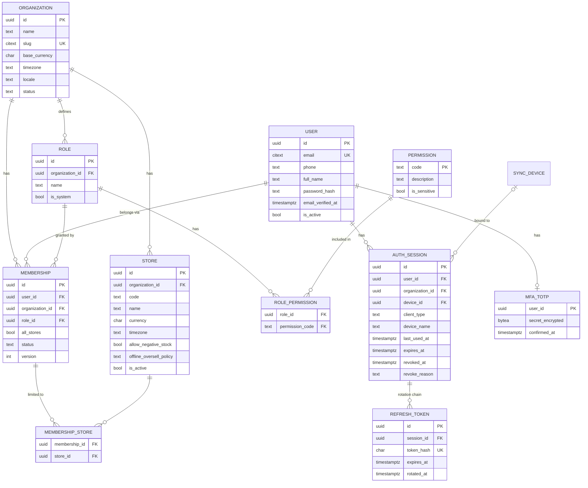
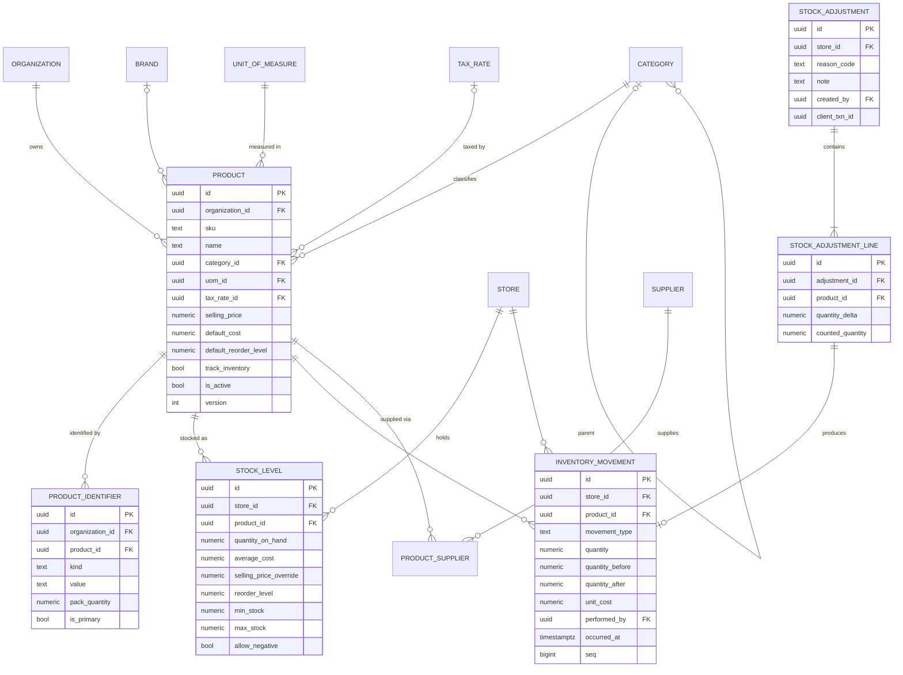
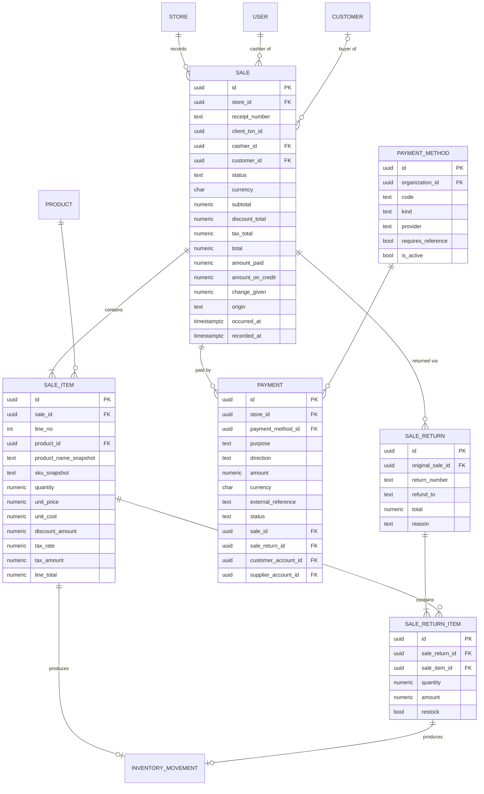
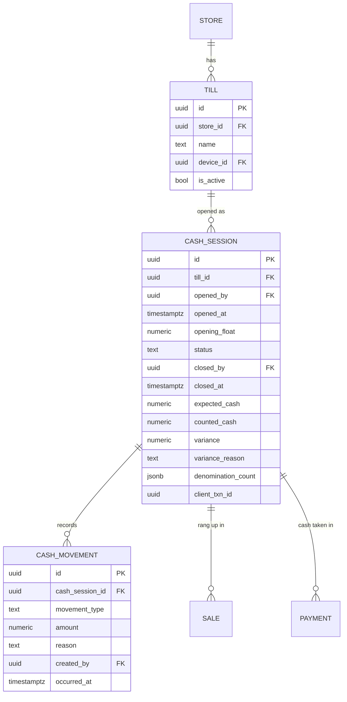
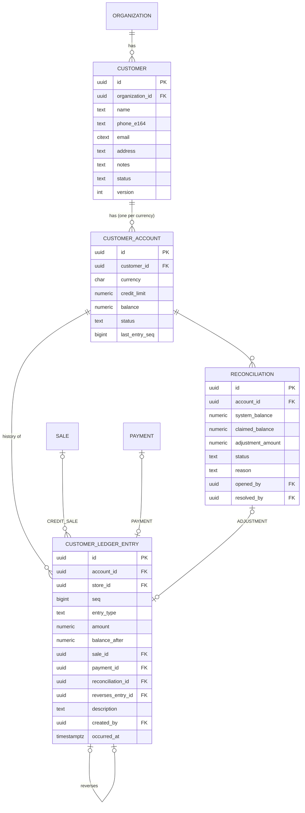
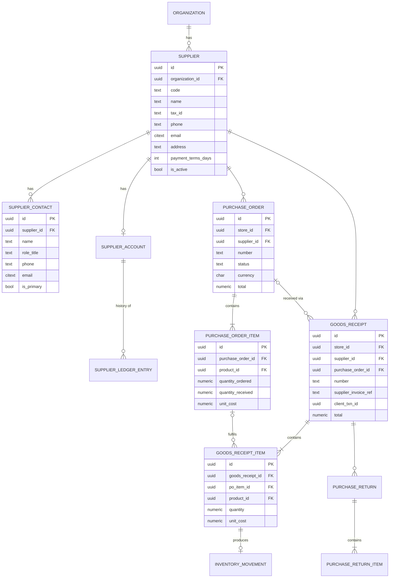
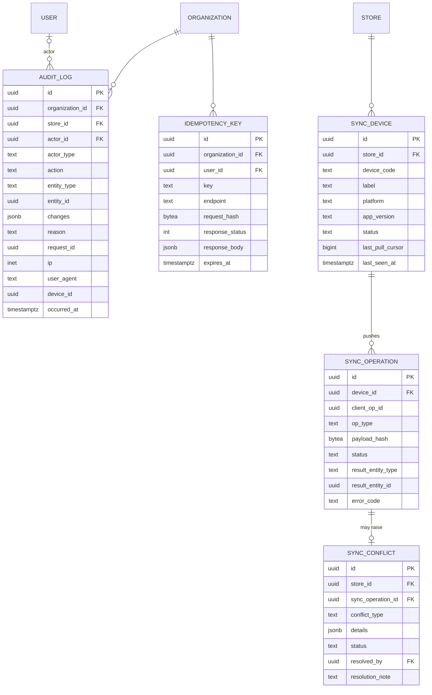

# ShopFlow — Database Design

Status: **Draft for review** (Phase 0). PostgreSQL 17. Django models will be the source of truth once implemented; this document describes the intended schema and its invariants.

---

## 1. Conventions

| Topic | Convention |
|---|---|
| Primary keys | `uuid`, time-ordered UUIDv7 generated by the app (good index locality, safe to expose, no enumeration) |
| Tenant column | Every tenant-owned table has `organization_id uuid NOT NULL` with an index. Store-scoped tables also have `store_id`. |
| Timestamps | `timestamptz`, stored in UTC. The business day is computed in the **store's** timezone. |
| Client time vs server time | Transactions keep both `occurred_at` (client/business time, may come from an offline device) and `recorded_at` (server `now()`, trusted). |
| Money | `numeric(19,4)` plus a `currency char(3)` on every financial document |
| Quantity | `numeric(14,3)`; whether fractions are allowed is set per unit of measure |
| Enums | `text` + `CHECK (col IN (...))`. Easier to migrate than PG enum types. |
| Soft delete | Master data (products, customers, suppliers) is deactivated with `is_active`, never deleted. Financial and transactional rows are **never** deleted. |
| Optimistic locking | Mutable master data has `version integer`, incremented on each update |
| Sync | Syncable tables have `row_version bigint`, set from a global sequence by trigger on insert and update (pull cursor) |
| Immutability | Append-only tables (§4) have a trigger that raises on UPDATE/DELETE. The application DB role is also not granted UPDATE/DELETE on them. |
| Naming | snake_case, singular table names prefixed by app (`catalog_product`). They appear unprefixed below for readability. |

Extensions: `pgcrypto`, `pg_trgm` (fuzzy product/customer search), `citext` (case-insensitive email).

---

## 2. Entity-relationship diagrams

The ERD is split by domain for readability. Columns shown are the important ones; §3 has full details.

### 2.1 Tenancy and access control

### 2.2 Catalog and inventory

### 2.3 Sales and payments

### 2.3a Cash control

### 2.4 Customers, ledger, reconciliation

### 2.5 Suppliers and purchasing

### 2.6 Audit, idempotency and sync

---

## 3. Table details: constraints and indexes

Only non-obvious constraints are listed. Every tenant table also has `organization_id` + index, `created_at` and `updated_at`.

### Tenancy and access

| Table | Key constraints / indexes |
|---|---|
| `organization` | `UNIQUE(slug)` |
| `store` | `UNIQUE(organization_id, code)`. `offline_oversell_policy IN ('QUEUE_FOR_REVIEW','ALLOW_NEGATIVE')` (see DECISIONS Q-4) |
| `user` | `UNIQUE(email)` (citext). Password stored only as a Django hash (Argon2id). |
| `membership` | `UNIQUE(user_id, organization_id)`. `status IN ('ACTIVE','SUSPENDED')` (`INVITED` arrives with invitations in 1.9). `version` for optimistic locking. The service prevents removing the last active Owner, locking owner rows while it checks. |
| `membership_store` | PK `(membership_id, store_id)`. Service ensures the store belongs to the membership's org. |
| `role` | `UNIQUE(organization_id, name)`. Partial `UNIQUE(organization_id) WHERE template = 'OWNER'` (one Owner role per business). `template IN (OWNER, MANAGER, CASHIER, CUSTOM)`. The Owner role is a system role: immutable, with no permission rows, implicitly holding every code. |
| `permission` | Code-defined catalog (`organizations/catalog.py`), synced after every `migrate`. Codes newly added to a template are granted to existing roles from that template; codes removed from the catalog are deleted. Not editable at runtime. |
| `one_time_token` | Hashed single-use tokens (`VERIFY_EMAIL`, `RESET_PASSWORD`, `MFA_CHALLENGE`) with `expires_at`, `used_at`, `attempts`, `payload`. `UNIQUE(token_hash)`. |
| `totp_device` | One per user. `secret_encrypted` (Fernet), `confirmed_at`, `last_used_counter` (replay protection). |
| `recovery_code` | Hashed, single-use. `UNIQUE(user_id, code_hash)`. |
| `invitation` | Tenant-owned. Hashed token, 7-day `expires_at`, `accepted_at`/`revoked_at`. Partial `UNIQUE(organization_id, email) WHERE pending`. |
| `auth_session` | One row per signed-in client (the "token family"). Partial index `(user_id) WHERE revoked_at IS NULL`. `CHECK(client_type IN ('WEB','MOBILE'))`. `CHECK` that `revoke_reason` is set exactly when `revoked_at` is. `mfa_verified` marks sessions that passed two-step verification. `organization_id` (1.6) and `device_id` (Phase 6) are added later. |
| `refresh_token` | **`UNIQUE(token_hash)`** (SHA-256 hex; the token itself is never stored). `rotated_at` marks a used token for reuse detection. Rows of ended sessions are purged by a scheduled job (2.6). |

### Catalog

| Table | Key constraints / indexes |
|---|---|
| `product` | `UNIQUE(organization_id, lower(sku))`. `CHECK(selling_price >= 0)`, `CHECK(default_cost >= 0)`. Services (`etims_product_type = '3'`) have `track_inventory = false`. Partial `UNIQUE(organization_id, etims_item_code)` when set. GIN trigram index on `name`. Index `(organization_id, category_id)`. `row_version` by trigger. A code (SKU or identifier) finds one product: the DB enforces it within each table, the service across both. |
| `product_identifier` | **`UNIQUE(organization_id, value)`**, so one barcode maps to exactly one product per org (the hot lookup path). `CHECK(pack_quantity > 0)`. Partial unique `(product_id) WHERE is_primary`. `kind IN ('BARCODE','QR','ALIAS')`. `row_version` by trigger. |
| `category` | `UNIQUE NULLS NOT DISTINCT (organization_id, parent_id, lower(name))`. `CHECK(parent_id <> id)`. Service prevents cycles (re-parenting serialized per org by an advisory lock). |
| `brand` | `UNIQUE(organization_id, lower(name))`. |
| `unit_of_measure` | `UNIQUE(organization_id, code)`. `CHECK(code ~ '^[A-Z0-9]{1,10}$')`, so codes are stored upper-case. Has `allows_fraction bool` and an optional `etims_quantity_unit` (KRA code list). |
| `tax_rate` | `UNIQUE(organization_id, lower(name))`. `CHECK(rate >= 0 AND rate < 1)`. Rates are never edited once used: create a new rate and repoint products. Optional `etims_tax_type` (A–E), checked against the rate by the API (not the DB, since rates change by law). |
| `product_price_history` | Append-only (trigger + no UPDATE/DELETE grant). Includes the price a product was created with (`old_price` NULL): `(product_id, store_id NULL, old_price, new_price, changed_by, changed_at)`. Feeds the price-history reports. |

### Inventory

| Table | Key constraints / indexes |
|---|---|
| `stock_level` | `UNIQUE(store_id, product_id)`. **`CHECK(allow_negative OR quantity_on_hand >= 0)`**. Only the inventory service writes it. |
| `inventory_movement` | **Append-only.** `CHECK(quantity <> 0)`. **`CHECK(quantity_after = quantity_before + quantity)`**. `movement_type IN ('PURCHASE','SALE','SALE_RETURN','PURCHASE_RETURN','ADJUSTMENT','DAMAGED','EXPIRED','TRANSFER_IN','TRANSFER_OUT','OPENING')`. One nullable FK per source document (`sale_item_id`, `sale_return_item_id`, `goods_receipt_item_id`, `purchase_return_item_id`, `stock_adjustment_line_id`, `stock_transfer_line_id`). A `CHECK` requires exactly one of them to be non-null and to match `movement_type` (`OPENING` uses the adjustment FK). Indexes: `(store_id, product_id, seq)`, `(organization_id, recorded_at)`, plus each source FK. |
| `stock_adjustment` | `UNIQUE(organization_id, client_txn_id)`. `reason_code IN ('OPENING_BALANCE','DAMAGED','EXPIRED','COUNT_CORRECTION','THEFT_LOSS','FOUND','OTHER')`. `note` is required when the reason is `OTHER`. |

Real FK columns per source type were chosen over a generic `(reference_type, reference_id)` pair. The database can then guarantee that every movement points at a real document (spec rule 6).

### Sales and payments

| Table | Key constraints / indexes |
|---|---|
| `sale` | `UNIQUE(store_id, receipt_number)`. **`UNIQUE(organization_id, client_txn_id)`**. `status IN ('COMPLETED','VOIDED')`. `CHECK(total >= 0)`. **`CHECK(amount_paid + amount_on_credit = total)`**. **`CHECK(amount_on_credit = 0 OR customer_id IS NOT NULL)`**. `origin IN ('WEB','MOBILE_ONLINE','MOBILE_OFFLINE')`. Indexes `(store_id, occurred_at)` and `(customer_id, occurred_at)`. |
| `sale_item` | `UNIQUE(sale_id, line_no)`. `CHECK(quantity > 0)`. `CHECK(unit_price >= 0)`. `CHECK(discount_amount >= 0)`. Snapshot columns are NOT NULL. `price_overridden bool` + `override_reason`. |
| `sale_return` | `UNIQUE(store_id, return_number)` (`MAIN-R2026-000001`), `UNIQUE(organization_id, client_txn_id)`. `refund_to IN ('PAYMENT','ACCOUNT')`. A reason is required. Refund payments point at it (`payment.sale_return_id`); account refunds are `SALE_RETURN` ledger entries pointing at it. |
| `sale_return_item` | `CHECK(quantity > 0)`. `UNIQUE(sale_return_id, sale_item_id)`. Service ensures `SUM(returned) <= sold` while holding a lock on the sale; the last unit of a line refunds exactly what's left of its total. |
| `payment_method` | `UNIQUE(organization_id, code)`, `CHECK(code ~ '^[A-Z0-9_]{2,20}$')`. `UNIQUE(organization_id, lower(name))`. `kind IN ('CASH','CARD','MOBILE_MONEY','BANK_TRANSFER','OTHER')`; **partial `UNIQUE(organization_id) WHERE kind = 'CASH'`**. `etims_payment_type IN ('01','04','05','06','07')` (KRA codes; `02`/`03` describe credit sales, Q-29). `position` orders the till buttons. Customer credit is **not** a payment method (see below). |
| `payment` | Partial `UNIQUE(payment_method_id, external_reference)` for confirmed or pending incoming payments with a reference (an M-Pesa code pays once). `position` keeps the tenders' order on a sale; `tendered` (cash handed over) `>= amount`. `CHECK(amount > 0)`. `direction IN ('IN','OUT')`. `purpose IN ('SALE','SALE_REFUND','ACCOUNT_SETTLEMENT','SUPPLIER_PAYMENT')`. `status IN ('PENDING','CONFIRMED','FAILED','REVERSED')`. A `CHECK` ties `purpose` to exactly one matching FK. `UNIQUE(organization_id, client_txn_id)`. |

| `till` | `UNIQUE(store_id, name)`. `device_id` is set for mobile tills. |
| `cash_session` | **Partial `UNIQUE(till_id) WHERE status = 'OPEN'`**. `status IN ('OPEN','CLOSED')`. `CHECK(opening_float >= 0)`. `CHECK(status = 'OPEN' OR (closed_by IS NOT NULL AND counted_cash IS NOT NULL AND variance = counted_cash - expected_cash))`. Immutable once `CLOSED` (trigger). `UNIQUE(organization_id, client_txn_id)`. |
| `cash_movement` | **Append-only.** `movement_type IN ('PAY_IN','PAY_OUT','DROP','CORRECTION')`. `CHECK(amount <> 0)`. A reason is required. Only allowed while the session is `OPEN`, except `CORRECTION`. |

`sale.cash_session_id`, `sale_return.cash_session_id` and `payment.cash_session_id` are nullable FKs. The service requires them for cash when the store setting `require_cash_session` is on (the default). `store.cash_variance_threshold` (default 100.00) sets when a close-out needs a reason. Voids set `sale.status = 'VOIDED'` with `voided_at`, `voided_by` and `void_reason` (a `CHECK` keeps them consistent) and reverse stock as `SALE_RETURN` movements against the sale's own lines. Every new store gets a till named "Till 1".

**Credit sales:** the part of a sale on credit is `sale.amount_on_credit` plus a `CREDIT_SALE` ledger entry. It is not a `payment` row, because no money moved. In the UI, "CREDIT" still looks like a tender button.

### Customers

| Table | Key constraints / indexes |
|---|---|
| `customer` | Index `(organization_id, phone_e164)` (not unique; see Q-16). GIN trigram index on `name`. |
| `customer_account` | `UNIQUE(customer_id, currency)`. `CHECK(credit_limit IS NULL OR credit_limit >= 0)` (NULL means no credit allowed). `CHECK(balance >= 0)` while overpayment is unsupported (Q-6). `status IN ('ACTIVE','FROZEN','CLOSED')`. |
| `customer_ledger_entry` | **Append-only.** `UNIQUE(account_id, seq)`. `CHECK(amount <> 0)`. `entry_type IN ('OPENING_BALANCE','CREDIT_SALE','PAYMENT','SALE_RETURN','ADJUSTMENT','REVERSAL')`. A `CHECK` ties each type to its source FK. **`UNIQUE(reverses_entry_id)`**, so an entry can be reversed at most once. Index `(account_id, occurred_at)`. |
| `reconciliation` | `status IN ('OPEN','RESOLVED_NO_CHANGE','RESOLVED_ADJUSTED','CANCELLED')`. `CHECK(status = 'OPEN' OR (resolved_by IS NOT NULL AND reason <> ''))`. |

### Suppliers and purchasing

| Table | Key constraints / indexes |
|---|---|
| `supplier` | `UNIQUE(organization_id, lower(code))`, `UNIQUE(organization_id, lower(name))`. `CHECK(kra_pin = '' OR kra_pin ~ '^[AP][0-9]{9}[A-Z]$')`. `CHECK(payment_terms_days <= 365)`. |
| `supplier_contact` | Partial `UNIQUE(supplier_id) WHERE is_primary`. Removable (audited). |
| `product_supplier` | `UNIQUE(product_id, supplier_id)`. Partial unique `(product_id) WHERE is_preferred`. `CHECK(min_order_qty IS NULL OR min_order_qty > 0)`. `CHECK(lead_time_days <= 365)`. `last_purchase_price` is set by goods receipts (5.1). |
| `purchase_order` | `UNIQUE(organization_id, number)`. `status IN ('DRAFT','ORDERED','PARTIALLY_RECEIVED','RECEIVED','CLOSED','CANCELLED')`. |
| `purchase_order_item` | `CHECK(quantity_received <= quantity_ordered)` (over-receipt policy: Q-18) |
| `goods_receipt` | `UNIQUE(organization_id, client_txn_id)`. `UNIQUE(store_id, number)`. |
| `supplier_ledger_entry` | Same append-only pattern as the customer ledger. Types: `INVOICE`, `PAYMENT`, `RETURN`, `ADJUSTMENT`, `REVERSAL`. |

### Audit, idempotency and sync

| Table | Key constraints / indexes |
|---|---|
| `audit_log` | **Append-only.** Index `(organization_id, entity_type, entity_id)` and `(organization_id, occurred_at)`. Monthly range partitions once volume warrants. |
| `idempotency_key` | **`UNIQUE(organization_id, key)`**, inserted in the same transaction as the change it guards. Also stores `user_id`, `endpoint` and `request_hash`; a replay must match all three. Index `(expires_at)` for purge (`manage.py purge_idempotency_keys`, scheduled in 2.6). |
| `sync_device` | `UNIQUE(store_id, device_code)` |
| `sync_operation` | **`UNIQUE(device_id, client_op_id)`** |
| `sync_conflict` | `status IN ('OPEN','ACCEPTED','REJECTED')`. Index `(store_id) WHERE status = 'OPEN'`. |
| `document_sequence` | `UNIQUE(store_id, doc_type, year)`: numbers restart each year (`MAIN-2026-000001`). Locked `FOR UPDATE` when issuing a number, in the transaction that uses it. |

---

## 4. Append-only tables

`inventory_movement`, `cash_movement`, `customer_ledger_entry`, `supplier_ledger_entry`, `audit_log`, `product_price_history`, `sync_operation` (results only, apart from a status transition from PENDING).

These are enforced three ways:
1. A `BEFORE UPDATE OR DELETE` trigger (`shopflow_prevent_modification()`) raises an exception. A test checks every append-only table has it.
2. The runtime DB role (`shopflow_app`) has only `SELECT, INSERT` on these tables. Migrations run as the schema owner. A model opts in with `append_only = True`; the grants are re-applied after every `migrate`.
3. The Django models override `save()`/`delete()` to refuse updates. This gives an early, friendly error; the DB is the real guard.

---

## 5. Invariants and where they are enforced

| # | Invariant (spec rule) | DB | Service | Verified by |
|---|---|---|---|---|
| 1–2 | Tenant/store isolation | FK + (Phase 8) RLS | Scoped managers, membership checks | Cross-tenant test suite |
| 3 | No negative stock unless allowed | `CHECK(allow_negative OR qoh >= 0)` | Lock + check with friendly error | Concurrency tests |
| 4–5 | Completed sales never deleted; corrections via reversals | No DELETE grant, status CHECK | Void/return services | API tests |
| 6 | Every stock change has a movement | Movement CHECK + source FK CHECK | Single write path | Nightly verifier |
| 7 | Balance derived from ledger | `UNIQUE(account_id, seq)` | Account lock | Nightly verifier |
| 9 | No duplicate transactions | `UNIQUE(org, client_txn_id)`, idempotency key, `(device, op_id)` | Idempotency claim | Idempotency tests |
| 10 | Concurrent sales safe | Row locks | Ordered locking | Threaded tests |
| 12 | Audit immutable | Trigger + grants | — | DB tests |
| 13–14 | Historical prices preserved | NOT NULL snapshot columns | — | Tests |
| 15 | Atomic multi-step operations | Transactions | `transaction.atomic` per service | Fault-injection tests |

---

## 6. Performance notes

- **Barcode lookup:** a unique btree on `(organization_id, value)`, then a join to `product` and `stock_level`. One indexed query, p95 well under 10 ms in the database.
- **Product search:** `pg_trgm` GIN on name, plus exact match on SKU and identifier.
- **Low-stock list:** `WHERE quantity_on_hand <= reorder_level` on `stock_level` filtered by store. Add an expression index if it gets slow.
- **Reports:** start with indexed OLTP queries. Add daily summary tables (`daily_sales_summary(store, day, …)`) maintained by a Celery job once data volume calls for it.
- **Connections:** Django 5.x psycopg 3 connection pool at first. Add PgBouncer in transaction mode when replica count × pool size approaches `max_connections`.
- **N+1:** selectors use `select_related`/`prefetch_related`. Tests assert query counts on list endpoints with `django_assert_max_num_queries`.
